#+title: fincl: Quantitative Finance in Common Lisp

(F)inance (in) (C)ommon (L)isp

*Warning: this library is rapidly changing! It is not ready for any sort of heavy lifting; it is merely a curiousity for now.*

* Systems
- =fincl=: main library
- =fincl/tests=: test suite for numerical correctness, and parity with QuantLib, where appropriate
- =fincl/benchmarks=: collection of benchmarks comparing quantitatve finance jobs in fincl to equivalent QuantLib (see [[file:./benchmarks/README.org][accompanying summary]]).
- =fincl/docgen=: documentation generation system with =mgl-pax=

An additional package =fincl-viz= is provided that provides helper utilities to visualize data that comes out of fincl. 

* Dependencies
- =fincl= requires SBCL, alexandria, special-functions, statistics, random-state, lparallel, bordeaux-threads, arrow-macros, iterate, named-readtables, and closer-mop.
- =fincl/tests= requires fincl, lparallel, closer-mop, magicl (to be removed), bordeaux-threads, and iterate
- =fincl/benchmarks= fincl, lparallel, iterate, and uiop, as well as QuantLib's C++ library to build the corresponding =.cpp= files
- =fincl-viz= (not part of =fincl=) requires python with numpy and matplotlib and py4cl for SBCL interop

* Using fincl
Refer to the currently rough [[file:./docs/README.org][documentation]] to get started. Please note that the
library is changing rapidly, and the documentation is far from a complete
reference to the library's code. Think of it more as a cookbook.

* Capabilities
- Options pricing :: Vanilla and handful of exotics, see [[file:./docs/options.org][options docs]]
- Greeks :: From Monte Carlo or likelihood estimator, implied volatility
- Monte Carlo :: Thread-invariant RNG, antithetic variables, control variates
- Bond and rate instrument pricing :: Fixed-rate bonds, interest swaps, swaptions
- Volatility calibration :: Calibrate stochastic processes to quoted option strip

*Above all: extensible by the user.*

* Showcase
The following are taken from =fincl/viz= demonstrations.

** Stochastic Processes

| 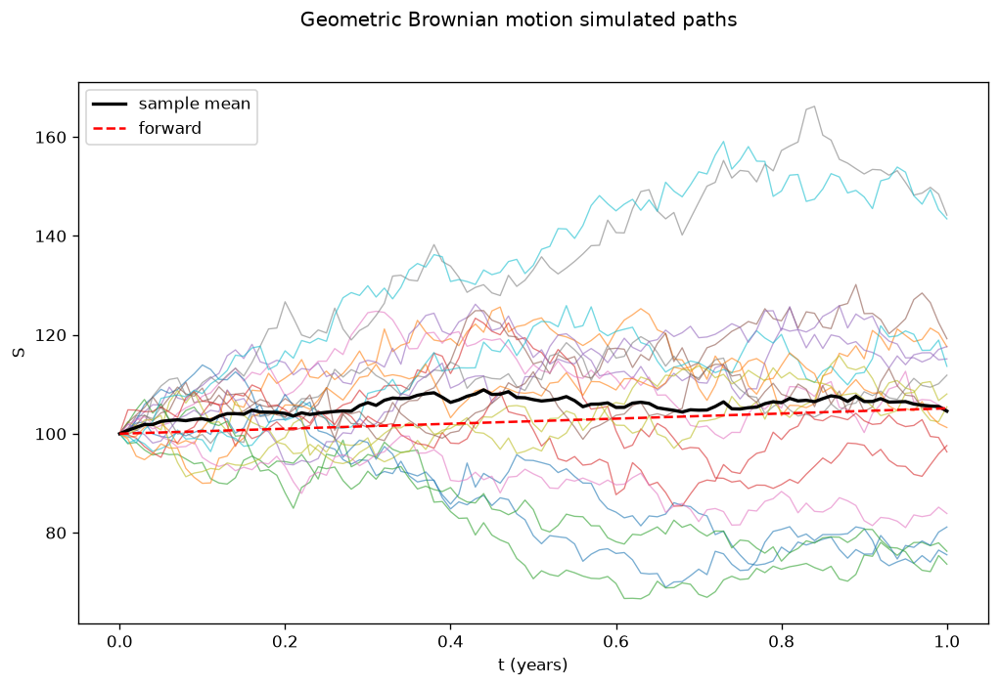 | 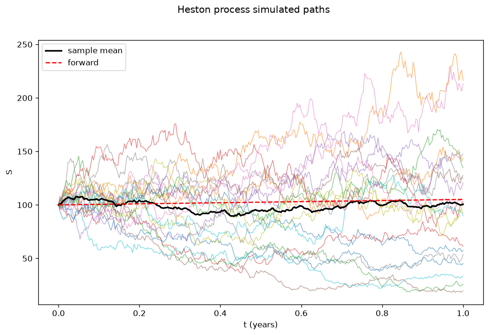 |
| 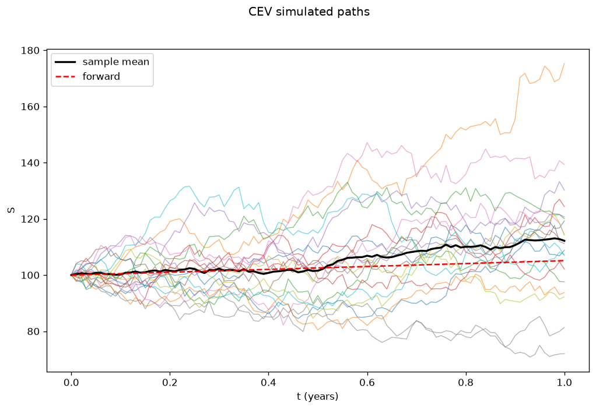 | 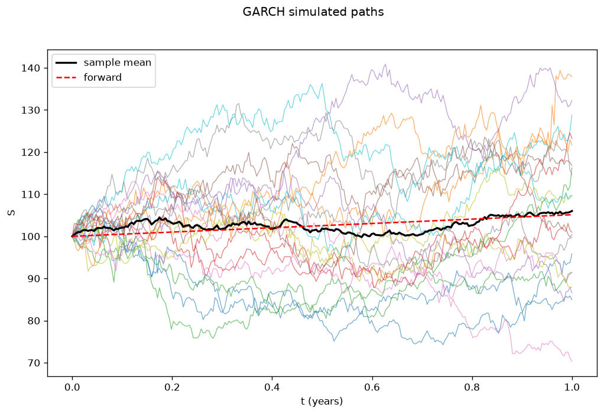  |

** Option Pricing and Statistics
| 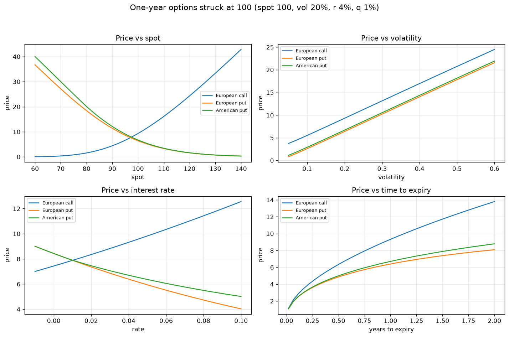  | 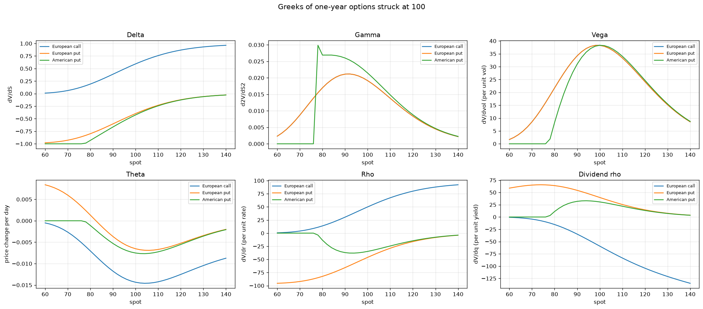 |
| 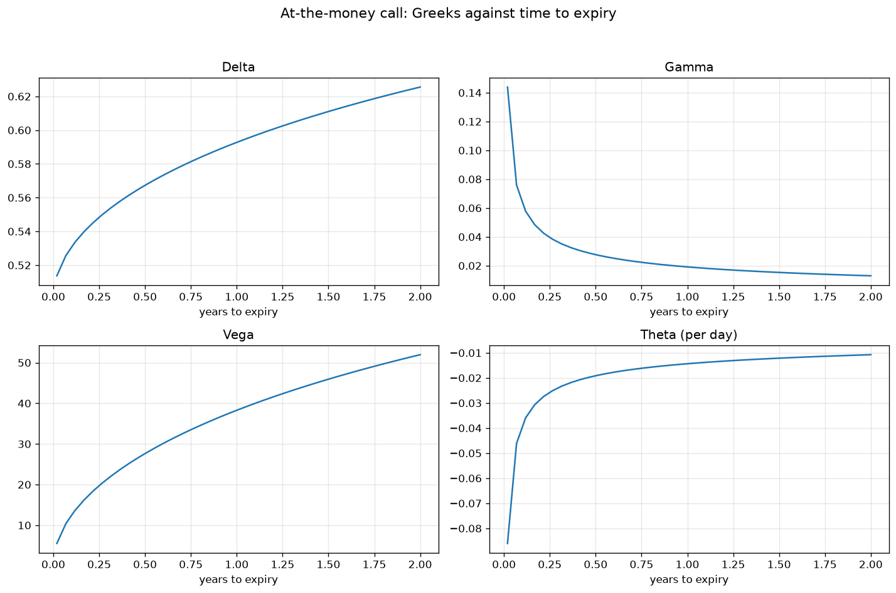 | 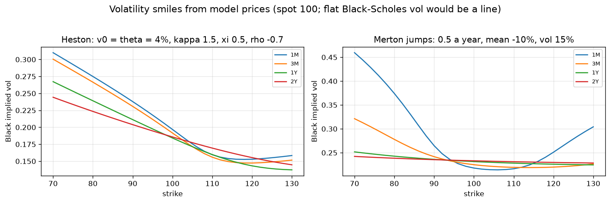                |

** Monte Carlo

| 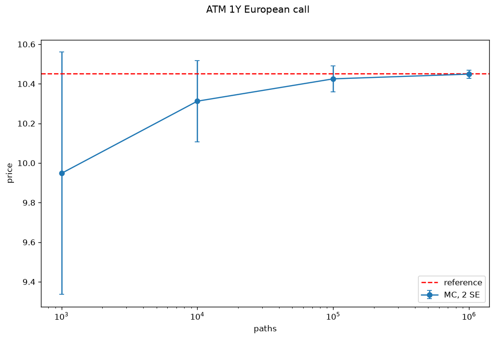 | 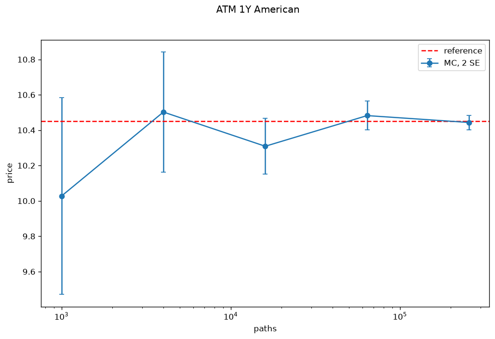 |
| 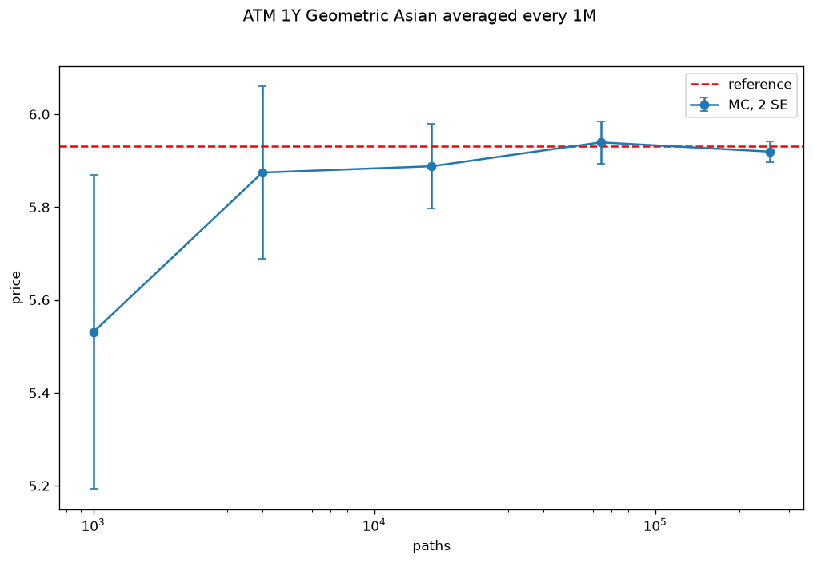                       |                                       |

** Volatility Calibration
| 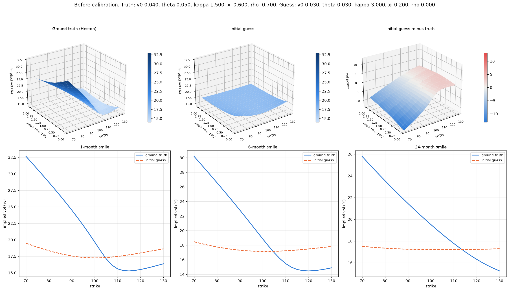 |
| 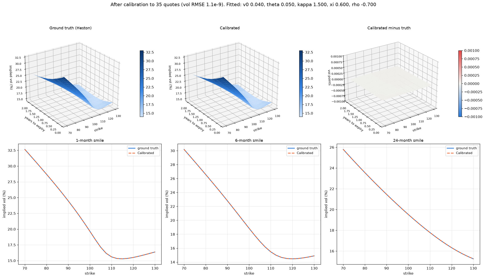 |
* LLM Disclosure
LLMs were supervised in creation of this code.
