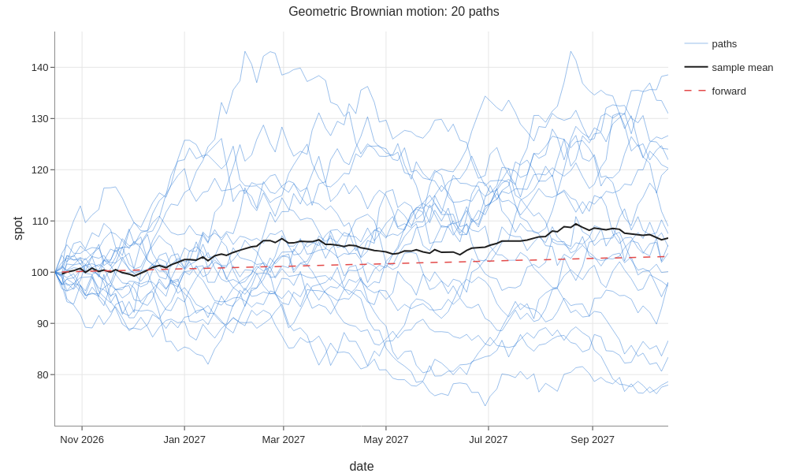
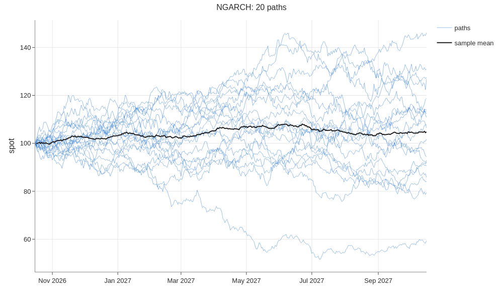
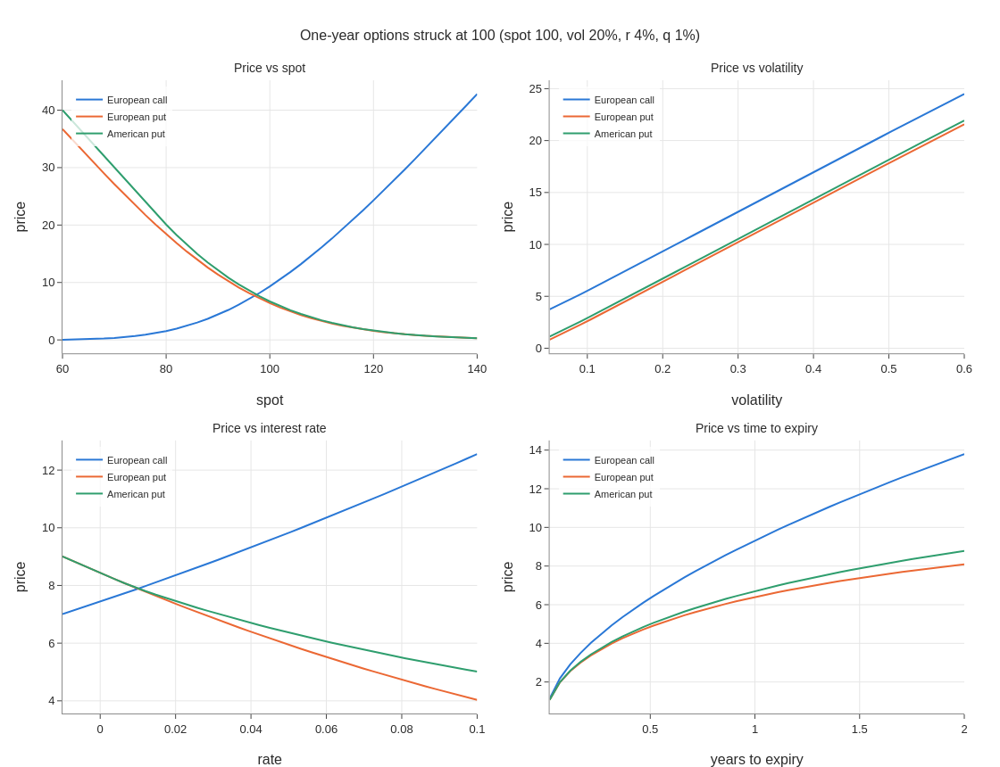
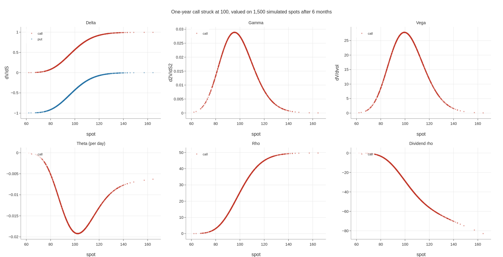
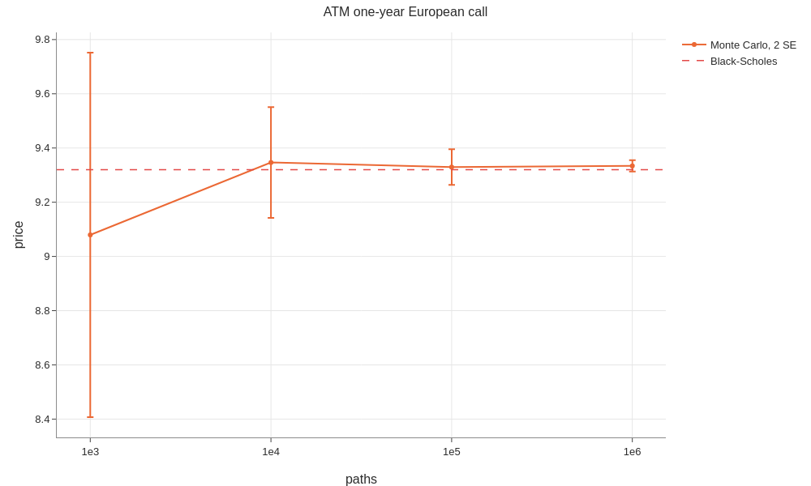
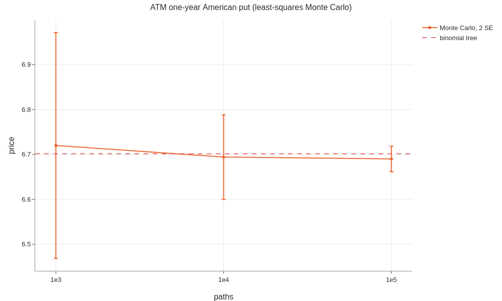
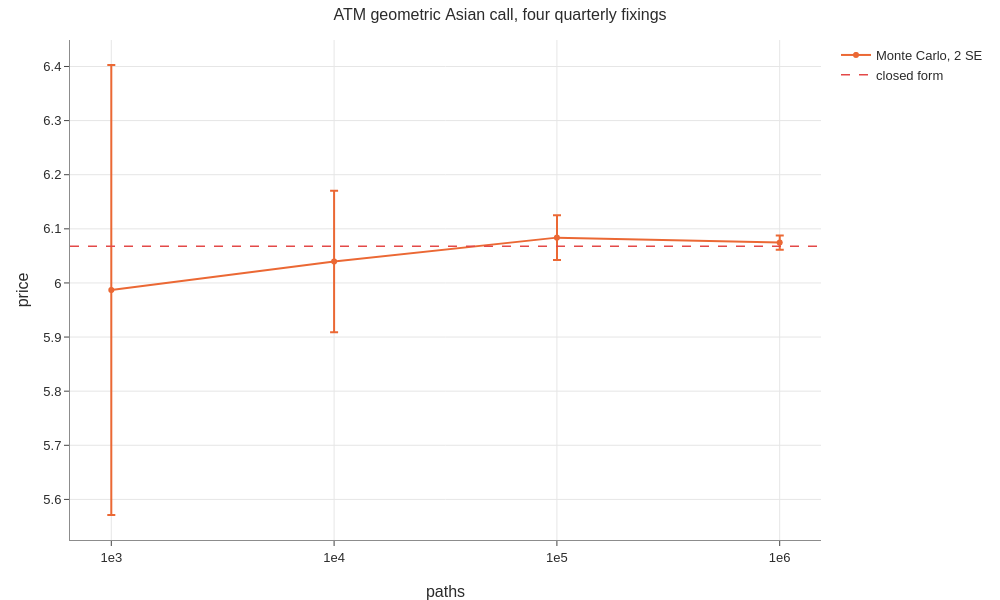
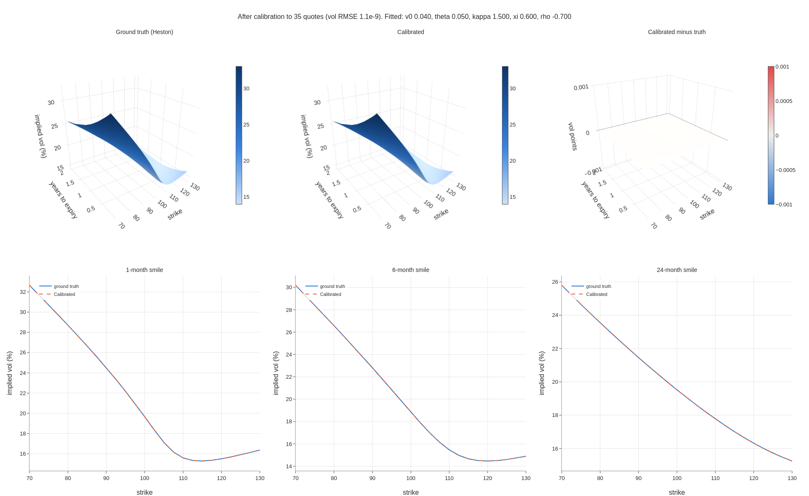

#+title: fincl: Quantitative Finance in Common Lisp

(F)inance (in) (C)ommon (L)isp

*Warning: this library is rapidly changing! It is not ready for any sort of heavy lifting.*

* Systems
- =fincl=: main library
- =fincl/tests=: test suite for numerical correctness, and parity with QuantLib, where appropriate
- =fincl/benchmarks=: collection of benchmarks comparing quantitatve finance jobs in fincl to equivalent QuantLib (see [[file:./benchmarks/README.org][accompanying summary]]).
- =fincl/docgen=: documentation generation system with =mgl-pax=

An additional package =fincl-viz= is provided that provides helper utilities to visualize data that comes out of fincl. 

* Dependencies
- =fincl= is built with SBCL, alexandria, special-functions, statistics, random-state, lparallel, bordeaux-threads, arrow-macros, iterate, named-readtables, and closer-mop.
- =fincl/tests= is built with fincl, lparallel, closer-mop, bordeaux-threads, and iterate
- =fincl/benchmarks= is built with fincl, lparallel, iterate, and uiop, as well as QuantLib's C++ library to build the corresponding =.cpp= files
- =fincl-viz= (not part of =fincl=) is built with jzon, and python with plotly (and kaleido for images) to render the Plotly JSON it writes through =viz/render.py=

* Capabilities
- Options pricing :: Vanilla and handful of exotics, see [[file:./tour/options.org][options docs]].
- Greeks :: From Monte Carlo or likelihood estimator, implied volatility.
- Monte Carlo Simulations :: Thread-invariant RNG, antithetic variables, control variates.
- Bond and rate instrument pricing :: Fixed-rate bonds, interest swaps, swaptions.
- Volatility calibration :: Calibrate stochastic processes to quoted option strip.
- Scenario simulation  :: Path generation used to simulate local variables along
  paths; summary statistics outputted with plot generation with =fincl-viz=.

*And extensible by the user.*

* Fincl Demos
Refer to the manual for a full reference.
** Setup
Acquire fincl locally and register it to quicklisp.
#+begin_src lisp :exports code
(ql:quickload :fincl)

(defpackage #:fincl-demos
  (:use #:cl #:fincl))

(in-package #:fincl-demos)

;; Optional: date and tenor syntax
(named-readtables:in-readtable fincl:syntax)

(defconstant +today+ #D"2026-10-01")

(defparameter *m*
  (make-market (valued-on +today+)
               (underlying :some-equity (spot 100) (vol 0.20d0))
               (curve :usd-ois (rate 0.04d0))))

(defparameter *o* (make-option (call 100) (expires #T"1Y" :from +today+)))

#+end_src

** Pricing Options
*** With Black-Scholes
#+HTML: 

#+HTML: 
Show code and output

The "Hello, World!" of quant finance is pricing an at-the-money call with the Black-Scholes equation.
#+begin_src lisp :exports both
(price  *o* :black-scholes *m*)
#+end_src

#+RESULTS:
: 9.925053717274428d0

As is hopefully apparent, this prices a =European 1Y 100C= on an asset of price =100= where we assume the asset follows a geometric Brownian motion with volatility =0.2= and the risk-free rate is =4%=.

#+HTML: 

*** Multi-Engine Option Pricing
#+HTML: 

#+HTML: 
Show code and output

Each engine prices under its own method and model assumptions. The binomial
tree, for example, assumes GBM. The following code prices an American =6D 100P=
with Monte Carlo, Fourier cosine, finite difference, binomial tree, and
Barone-Adesi-Whaley. Each row gives the engine, the price, and the standard
error. Only Monte Carlo has a standard error. The Monte Carlo price is within
two standard errors of the other prices. Barone-Adesi-Whaley is an
approximation, so it differs from the others by more.
#+begin_src lisp :results value :exports both
(defparameter *american* (make-option (put 100)
                                      (american)
                                      (expires #T"6D" :from +today+)))

(loop :for engine :in '(:mc :cos :fd :binomial :baw)
      :collect
      (multiple-value-bind (npv se) (price *american* engine *m*)
        `(,engine ,npv ,se)))
#+end_src

#+RESULTS:
| :MC       | 0.9973446422465597d0 | 0.002498042706923224d0 |
| :COS      | 0.9938338080252532d0 | NIL                    |
| :FD       | 0.9937860766551418d0 | NIL                    |
| :BINOMIAL | 0.9938380098631531d0 | NIL                    |
| :BAW      | 0.9925677875126846d0 | NIL                    |

#+HTML: 

*** Path Featured and Exotic Options
#+HTML: 

#+HTML: 
Show code and output

The library supports some exotic options, such as Asian options and barriers.
The Asian option has a closed-form price. The barrier option uses Monte Carlo.
#+begin_src lisp :results value :exports both
(defparameter *asian* (make-option (call 100)
                                   (expires #D"2027-10-01")
                                   (average :geometric :every #T"1W" :from +today+)))

(defparameter weekly (loop :for k :from 1 :to 12
                           :collect (add-tenor +today+ (make-tenor k :weeks))))
(defparameter *barrier* (make-option (call 100)
                                     (barrier :up-and-in 110 :monitoring weekly)
                                     (expires #D"2027-10-01")))

`(:asian ,(price *asian* :black-scholes *m*) :barrier ,(price *barrier* :mc *m*))
#+end_src

#+RESULTS:
| :ASIAN | 5.305773252030792d0 | :BARRIER | 4.60502377184317d0 |

#+HTML: 

*** Worker-Invariant Monte Carlo Pricing
#+HTML: 

#+HTML: 
Show code and output

Monte Carlo pricing uses =lparallel= workers.
The random normals come from Philox counters, so a price does not depend on the worker count.
The following code prices one call with a single worker and then with a worker pool. The two prices are identical.
#+begin_src lisp :results value :exports both
(defparameter *bates* (make-bates :v0 0.23d0 :kappa 1.5d0 :rho 0.6d0 :intensity 1/4))
(defparameter *bates-mc* (make-engine :mc :process *bates*))

`(,(price *o* *bates-mc* *m*)                 ; single worker
  ,(with-pricing-kernel ()                    ; worker pool
     (price *o* *bates-mc* *m*)))
#+end_src

#+RESULTS:
| 21.086668272547335d0 | 21.086668272547335d0 |

#+HTML: 

** Options as Data
#+HTML: 

#+HTML: 
Show code and output

An option is built from clauses, and it prints as the clauses that built it.
The printed form reads back to an equal option. The macro =make-option= lists its own clauses.
#+begin_src lisp :results value :exports both
(defparameter *barrier-put* (make-option (put 95)
                                         (barrier :down-and-out 85)
                                         (expires #T"1Y" :from +today+)))

`(,*barrier-put* ,(round-trip-p 'option *barrier-put*))
#+end_src

#+RESULTS:
| #<OPTION (put 95.0d0) (expires #D"2027-10-01") (barrier :down-and-out 85.0d0 :rebate 0.0d0 :monitoring :continuous)> | T |

#+begin_src lisp :results value :exports both
(mapcar (lambda (c) (getf c :name)) (language-clauses 'option))
#+end_src

#+RESULTS:
| CONVENTION | CALL | PUT | PAYOFF | UNDERLYING | CURRENCY | EUROPEAN | AMERICAN | BERMUDAN | EXPIRES | AVERAGE | BARRIER | LOOKBACK |

#+HTML: 

** Automatic Engine Selection
#+HTML: 

#+HTML: 
Show code and output

Pass =:auto= in place of an engine, and fincl chooses the first engine that can price the option.
The third value of =price= names the engine. The following code prices a European call, the American put, and the barrier put.
The =with-engines= form then replaces the engine for American options.
#+begin_src lisp :results value :exports both
`(,@(loop :for o :in (list *o* *american* *barrier-put*)
          :collect (nth-value 2 (price o :auto *m*)))
  ,(with-engines ((:american :baw))
     (nth-value 2 (price *american* :auto *m*))))
#+end_src

#+RESULTS:
| #<ENGINE (make-engine :black-scholes)> | #<ENGINE (make-engine :binomial)> | #<ENGINE (make-engine :black-scholes)> | #<ENGINE (make-engine :baw)> |

#+HTML: 

** Portfolios and Scenarios
#+HTML: 

#+HTML: 
Show code and output

A portfolio holds signed positions in options and in the underlying asset.
The following code prices a book, then revalues it on a grid of spot moves (-10%, 0, +10%) and vol moves (-5%, 0, +5%).
Each result is the book profit or loss for one scenario.
#+begin_src lisp :results value :exports both
(defparameter *book*
  (make-portfolio "book"
                  (make-position *o* :quantity 10)
                  (make-position *american* :quantity -5)
                  (make-position (make-holding) :quantity -3)))

(let ((grid (spot-vol-grid :some-equity '(-1/10 0 1/10) '(-5/100 0 5/100))))
  `(,(price *book* :auto *m*)
    ,@(coerce (scenario-pnl (revalue *book* *m* grid)) 'list)))
#+end_src

#+RESULTS:
| -205.71865287657147d0 | -83.86562423587512d0 | -66.65695620126577d0 | -48.996268054379016d0 | -17.687978706579983d0 | 0.0d0 | 17.842856454492598d0 | 30.331108118223582d0 | 45.40514116281598d0 | 62.370735558658566d0 |

#+HTML: 

** Simulating a Strategy Along Paths
#+HTML: 

#+HTML: 
Show code and output

=simulate= steps paths of a process and runs Lisp forms on chosen dates.
The following code sells a 1Y call and hedges it with the Black-Scholes delta once a month, on 20,000 GBM paths.
Cash earns the 4% rate of the market. The output is the hedged profit or loss at expiry.
The results are the mean, its standard error, and the 5% and 95% quantiles.
#+begin_src lisp :results value :exports both
(defparameter *monthly* (loop :for k :from 1 :to 12
                              :collect (add-tenor +today+ (make-tenor k :months))))

(defparameter *hedge*
  (simulate ((make-gbm) *m* *monthly* :n-paths 20000 :keep :quantiles)
    (:accumulate (shares 0d0) (cash 0d0))
    (:state s :spot)
    (:start (market)
      (incf cash (price *o* :black-scholes market)))     ; premium received
    (:every (date market &key dt)
      (setf cash (* cash (exp (* 0.04d0 dt))))           ; interest
      (when (date< date #D"2027-10-01")
        (let ((delta (getf (greeks *o* :black-scholes market :which '(:delta)) :delta)))
          (decf cash (* (- delta shares) s))             ; trade to the new delta
          (setf shares delta))))
    (:final (:hedged (+ cash (* shares s) (- (max 0d0 (- s 100d0))))))))

`(,(simulation-mean *hedge* :hedged)
  ,(simulation-standard-error *hedge* :hedged)
  ,(simulation-quantile *hedge* :hedged 0.05d0)
  ,(simulation-quantile *hedge* :hedged 0.95d0))
#+end_src

#+RESULTS:
| -0.019438996263710442d0 | 0.02973141133913993d0 | -7.498949460374341d0 | 6.2130117071651005d0 |

The mean is near zero, as predicted by risk-neutral asset pricing. Monthly
hedging leaves a wide spread. The spread falls with the square root of the
number of hedge dates: it is 4.2 with 12 dates and 2.0 with 53 dates.

#+HTML: 

* Visualizations
The following are taken from =fincl/viz= demonstrations.

** Stochastic Processes

|  | [[./viz/images/README-figures/heston-sim.png]] |
| [[./viz/images/README-figures/cev-sim.png]] |   |

** Option Pricing and Statistics
|   |  |
| [[./viz/images/README-figures/greeks-vs-expiry.png]] | [[./viz/images/README-figures/volatility-smiles.png]]                |

** Monte Carlo

|  |  |
|                        |                                       |

** Volatility Calibration
| [[./viz/images/README-figures/calibration-before.png]] |
|  |
* LLM Disclosure
LLMs were supervised in creation of this code.
