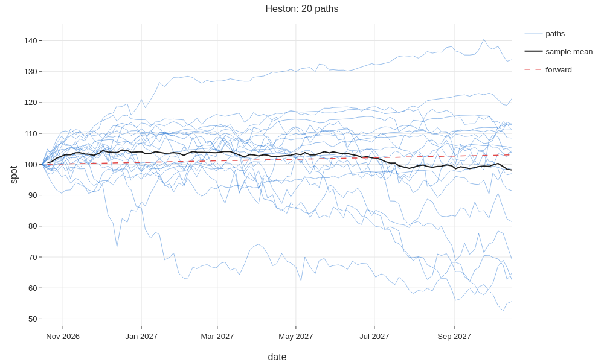
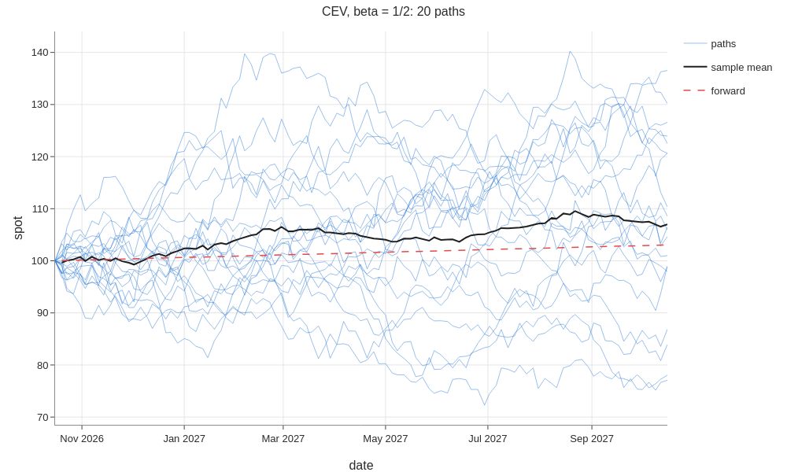
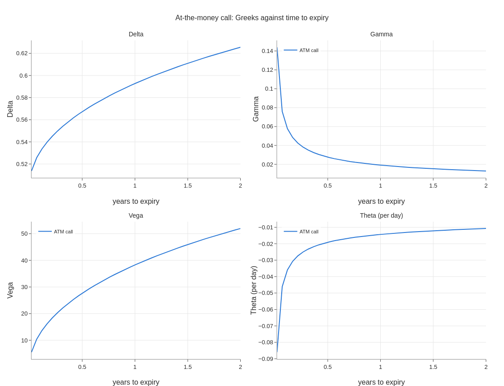
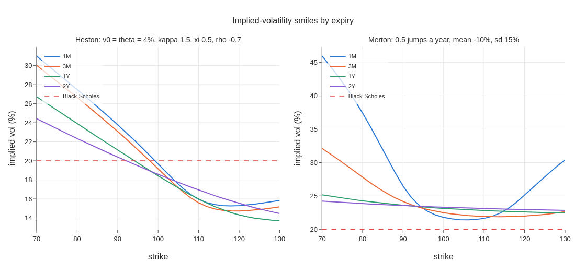
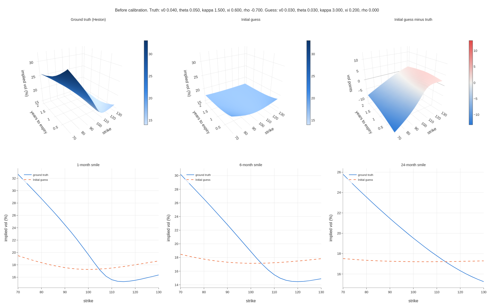

#+title: fincl: Quantitative Finance in Common Lisp

(F)inance (in) (C)ommon (L)isp

*Warning: this library is rapidly changing! It is not ready for any sort of heavy lifting.*

* Systems
- =fincl=: main library
- =fincl/tests=: test suite for numerical correctness, and parity with QuantLib, where appropriate
- =fincl/benchmarks=: collection of benchmarks comparing quantitatve finance jobs in fincl to equivalent QuantLib (see [[file:./benchmarks/README.org][accompanying summary]]).
- =fincl/docgen=: documentation generation system with =mgl-pax=

An additional package =fincl-viz= is provided that provides helper utilities to visualize data that comes out of fincl. 

* Dependencies
- =fincl= is built with SBCL, alexandria, special-functions, statistics, random-state, lparallel, bordeaux-threads, arrow-macros, iterate, named-readtables, and closer-mop.
- =fincl/tests= is built with fincl, lparallel, closer-mop, bordeaux-threads, and iterate
- =fincl/benchmarks= is built with fincl, lparallel, iterate, and uiop, as well as QuantLib's C++ library to build the corresponding =.cpp= files
- =fincl-viz= (not part of =fincl=) is built with jzon, and python with plotly (and kaleido for images) to render the Plotly JSON it writes through =viz/render.py=

* Using fincl
Refer to the manual for a full reference.
** Setup
Acquire fincl locally and register it to quicklisp.
#+begin_src lisp :exports code
(ql:quickload :fincl)

(defpackage #:fincl-demos
  (:use #:cl #:fincl))

(in-package #:fincl-demos)

;; Optional: date and tenor syntax
(named-readtables:in-readtable fincl:syntax)

(defconstant +today+ #D"2026-10-01")

(defparameter *m*
  (make-market (valued-on +today+)
               (underlying :some-equity (spot 100) (vol 0.20d0))
               (curve :usd-ois (rate 0.04d0))))

(defparameter *o* (make-option (call 100) (expires #T"1Y" :from +today+)))

#+end_src

** Pricing an option with Black-Scholes
The "Hello, World!" of quant finance is pricing an at-the-money call with the Black-Scholes equation.
#+begin_src lisp :exports both
(price  *o* :black-scholes *m*)
#+end_src

#+RESULTS:
: 9.925053717274428d0

As is hopefully apparent, this prices a =European 1Y 100C= on an asset of price =100= where we assume the asset follows a geometric Brownian motion with volatility =0.2= and the risk-free rate is =4%=.

** Multi-Engine Option Pricing
A variety of (semi)analytic engines exist for pricing options, each assuming the
underlying asset dynamics they were derived under (e.g. GBM for binomial tree).
The following prices an American =6D 100P= using Monte Carlo, Fourier cosine,
finite difference, binomial tree, and the approximation of Barone-Adesi-Whaley.
#+begin_src lisp :results value :exports both
(defparameter *american* (make-option (put 100)
                                      (american)
                                      (expires #T"6D" :from +today+)))

(loop :for engine :in '(:mc :cos :fd :binomial :baw)
      :collect
      (price *american* engine *m*))
#+end_src

#+RESULTS:
| 0.9973446422465597d0 | 0.9938338080252532d0 | 0.9937860766551418d0 | 0.9938380098631531d0 | 0.9925677875126846d0 |

** Path Featured and Exotic Options
Some exotic options are supported, such as Asian options and barriers.
#+begin_src lisp :results value :exports both
(defparameter *asian* (make-option (call 100)
                                   (expires #D"2027-10-01")
                                   (average :geometric :every #T"1W" :from +today+)))

(defparameter weekly (loop :for k :from 1 :to 12
                           :collect (add-tenor +today+ (make-tenor k :weeks))))
(defparameter *barrier* (make-option (call 100)
                                     (barrier :up-and-in 110 :monitoring weekly)
                                     (expires #D"2027-10-01")))

`(,(price *asian* :black-scholes *m*) ,(price *barrier* :mc *m*))
#+end_src

#+RESULTS:
| 5.305773252030792d0 | 4.60502377184317d0 |

** Worker-Invariant Monte Carlo Pricing
Backed by =lparallel=, fincl trivially allows multi-worker Monte Carlo pricing.
Using the Philox counters for generating random normals, pricing will be
reproducible and worker count-invariant.
#+begin_src lisp :results value :exports both
(defparameter *bates* (make-bates :v0 0.23 :kappa 1.5 :rho 0.6 :intensity 1/4))
(defparameter *bates-mc* (make-engine :mc :process *bates*))

(eql
 ;; Default: price with single worker
 (price *o* *bates-mc* *m*)
 ;; Price with multiple workers
 (with-pricing-kernel ()
   (price *o* *bates-mc* *m*)))
#+end_src

#+RESULTS:
: T

** Calibrating a Heston local vol model
#+begin_src lisp :results value :exports both
;; Three strips of options at 3M, 6M, and 1Y expiries
(defparameter *option-strip* (loop :for i :from -3 :to 3
                                   :append
                                   (loop
                                     :for e :in '(#T"3M" #T"6M" #T"1Y")
                                     :collect
                                     (make-option (call (+ 100 (* i 5)))
                                                  (expires e :from +today+)))))

;; Actual process the options are priced based off
(defparameter *true-process* (make-heston :v0 0.25d0 :kappa 1.5d0 :rho 0.7d0))

;; Price options and initialize as quotes
;; Priced by Fourier cosine method of Fang-Oosterlee
(defparameter *strip-prices* (mapcar (lambda (o)
                                       (price o (make-engine :cos :process *true-process*) *m*))
                                     *option-strip*))

(defparameter *quotes* (loop :for o :in *option-strip*
                             :for p :in *strip-prices*
                             :collect
                             (make-option-quote o :price p)))
;; Guess for true process
(defparameter *guess* (make-heston))

;; Calibrate guess process to 3M, 6M, and 1Y volatility smirks
(calibrate *guess* *m* *quotes*)
#+end_src

#+RESULTS:
#+begin_example
#<HESTON v0=0.2499999999974078 kappa=1.5000000004244283 theta=0.24999999997019723 xi=0.29999999917912645 rho=0.700000001895347 scheme=QUADRATIC-EXPONENTIAL>
(:RMSE 1.0865751787231957d-12 :MAX-ERROR 2.2857826742495035d-12 :ITERATIONS 327
 :RESIDUALS
 (-2.2857826742495035d-12 -5.2297055574968d-13 -1.281696970778512d-12
  -2.240430063693566d-13 1.0535461392180423d-12 -2.4030777368011513d-13
  7.189804307472514d-13 1.7686407893791056d-12 2.666755705149626d-13
  8.262279749260415d-13 1.8317569683290458d-12 3.552713678800501d-13
  3.086420008457935d-13 1.3963274980710594d-12 1.1191048088221578d-13
  -6.760147996942578d-13 5.782041512247815d-13 -3.913536161803677d-13
  -2.013278432855259d-12 -5.306866057708248d-13 -1.1033396418724806d-12)
 :PARAMETERS
 (:V0 0.2499999999974078d0 :KAPPA 1.5000000004244283d0 :THETA
  0.24999999997019723d0 :XI 0.29999999917912645d0 :RHO 0.700000001895347d0))
#+end_example

* Capabilities
- Options pricing :: Vanilla and handful of exotics, see [[file:./tour/options.org][options docs]].
- Greeks :: From Monte Carlo or likelihood estimator, implied volatility.
- Monte Carlo Simulations :: Thread-invariant RNG, antithetic variables, control variates.
- Bond and rate instrument pricing :: Fixed-rate bonds, interest swaps, swaptions.
- Volatility calibration :: Calibrate stochastic processes to quoted option strip.
- Scenario simulation  :: Path generation used to simulate local variables along
  paths; summary statistics outputted with plot generation with =fincl-viz=.

*And extensible by the user.*

* Showcase
The following are taken from =fincl/viz= demonstrations.

** Stochastic Processes

| [[./viz/images/README-figures/gbm-sim.png]] |  |
|  | [[./viz/images/README-figures/garch-sim.png]]  |

** Option Pricing and Statistics
| [[./viz/images/README-figures/price-vs-inputs.png]]  | [[./viz/images/README-figures/greeks-vs-spot.png]] |
|  |                 |

** Monte Carlo

| [[./viz/images/README-figures/euro-convergence.png]] | [[./viz/images/README-figures/american-convergence.png]] |
| [[./viz/images/README-figures/asian-convergence.png]]                       |                                       |

** Volatility Calibration
|  |
| [[./viz/images/README-figures/calibration-after.png]] |
* LLM Disclosure
LLMs were supervised in creation of this code.
